# Insight for Windows

**[Download for Windows](https://ombdj1209.github.io/insight/#get) · [Website](https://ombdj1209.github.io/insight/)**

**Your meetings, understood.** Insight is a private, on-device meeting companion for Windows. It listens to your
microphone and everything your PC plays (Teams, Zoom, Meet, Webex in a browser or app, or the people across the table),
transcribes in 53 languages, turns your shorthand into clear notes, tracks who promised what, and answers questions
from your own files and meetings with exact citations, during the meeting and after it.

No bot joins your call. Speech recognition and search run on your PC, and with the local AI model nothing leaves it
after the one-time model download. Cloud AI and Google / Microsoft accounts are optional.

<picture>
  <source media="(prefers-color-scheme: dark)" srcset="site/assets/dark-notes.webp">
  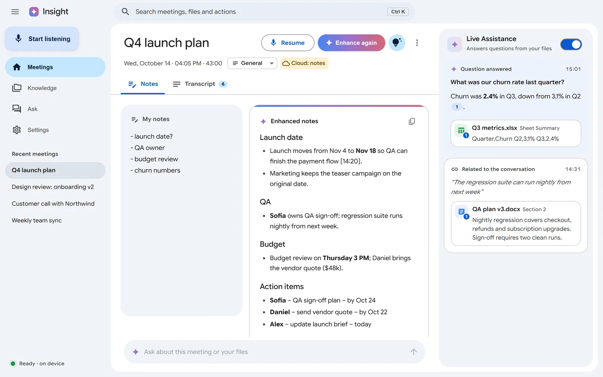
</picture>

<p align="center">
  <a href="https://ombdj1209.github.io/insight/#film"></a><br>
  <sub><a href="https://ombdj1209.github.io/insight/#film">▶ Watch the launch film (3:12)</a></sub>
</p>

## Screens

<table>
  <tr>
    <td width="50%"><picture><source media="(prefers-color-scheme: dark)" srcset="site/assets/dark-transcript.webp">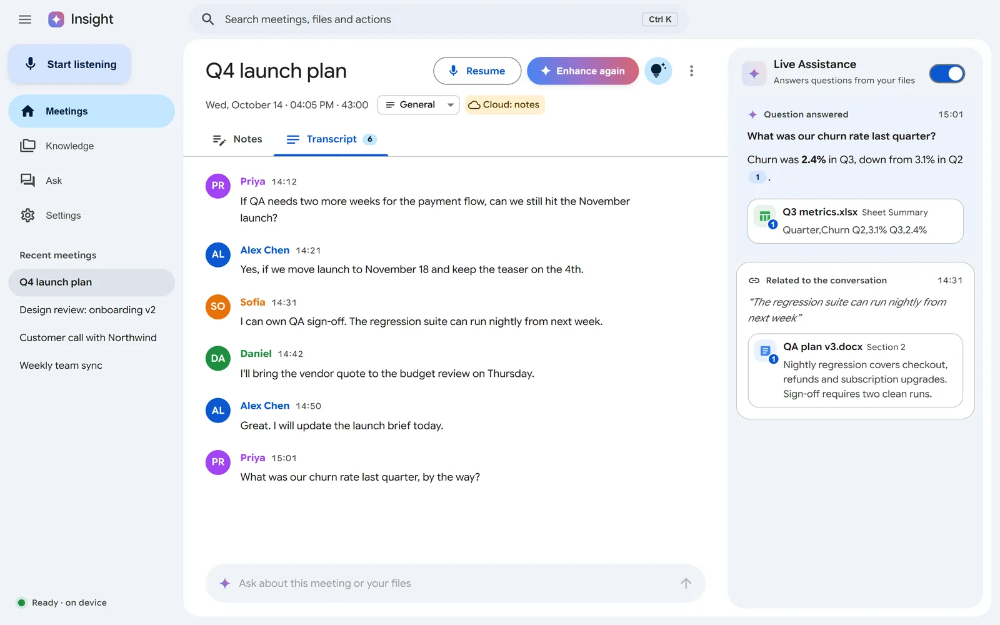</picture><br><b>Live transcript.</b> Every voice, with speakers told apart, and answers from your files while people talk.</td>
    <td width="50%"><picture><source media="(prefers-color-scheme: dark)" srcset="site/assets/dark-reminder.webp">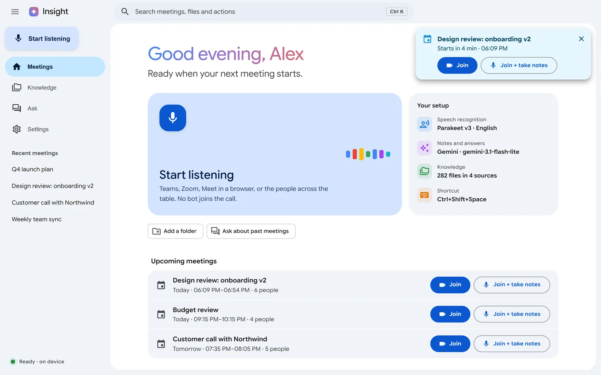</picture><br><b>Reminders with Join.</b> Join, or Join + notes to start listening in the same click.</td>
  </tr>
  <tr>
    <td><picture><source media="(prefers-color-scheme: dark)" srcset="site/assets/dark-ask.webp">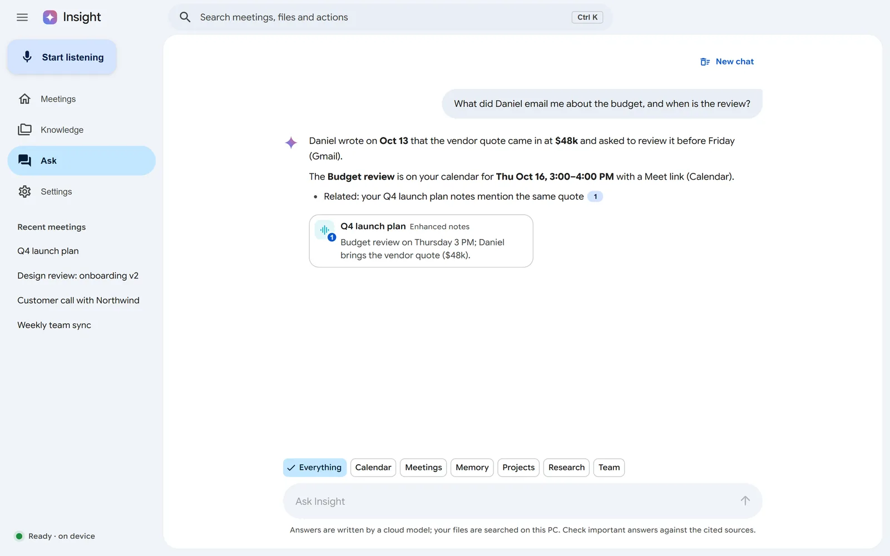</picture><br><b>Ask.</b> Questions across your files and every meeting, with citations that open the source.</td>
    <td><picture><source media="(prefers-color-scheme: dark)" srcset="site/assets/dark-knowledge.webp">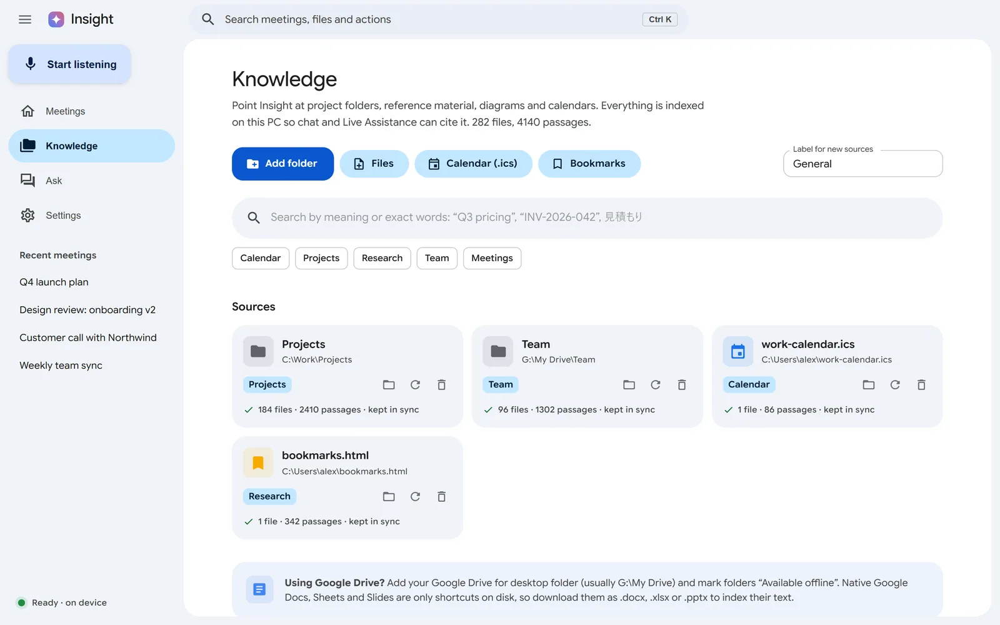</picture><br><b>Knowledge.</b> Point it at folders, calendars and bookmarks; everything is indexed on your PC.</td>
  </tr>
  <tr>
    <td>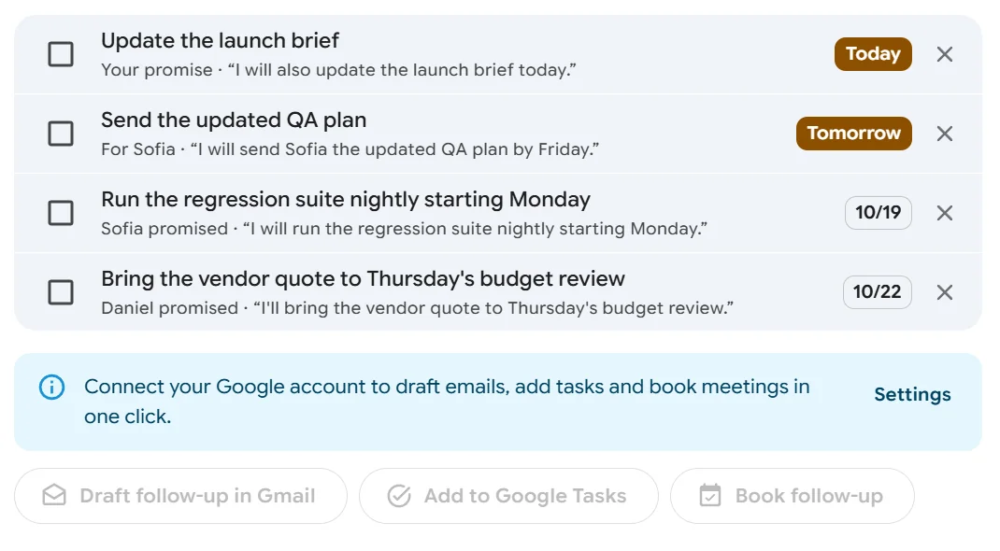<br><b>Promises.</b> Who promised what, by when, decided from the speaker labels.</td>
    <td><picture><source media="(prefers-color-scheme: dark)" srcset="site/assets/dark-petpage.webp">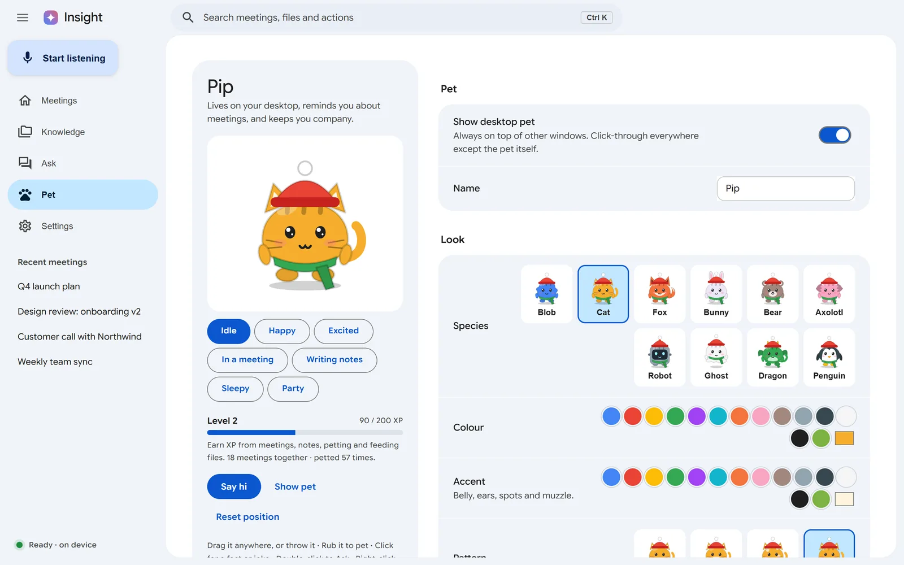</picture><br><b>Your pet.</b> Species, colours, patterns, hats and moods.</td>
  </tr>
</table>

## Features

**During the meeting**
- **Two-channel capture**: your microphone and system audio (Windows loopback), so "you" and "others" are separated
  reliably; voices on the other side are clustered into Speaker 1, 2, 3 (click to rename). In-room mode separates people
  sharing one microphone.
- **Live transcript** in 53 languages with the best installed engine per language (SenseVoice, Parakeet, ReazonSpeech,
  Whisper, Gemma 4 audio, or a cloud API).
- **Live Assistance**: when someone asks a question your files can answer, a cited answer card appears; related-file
  cards surface when the conversation turns to something in your knowledge.
- **Live captions**: an always-on-top caption bar with an instant translation line into any of 39 languages
  (Ctrl+Shift+L).
- **Slide capture** (opt-in): every new slide or shared document is saved, read and made searchable with the meeting.
- **Call detection**: when Zoom, Teams, Meet, Webex or Slack starts using the microphone, Insight offers to take notes.

**After the meeting**
- **Enhanced notes** from your shorthand and the transcript, with templates (client call, standup, 1:1, interview,
  sales discovery, kickoff), Markdown export and translation into any language.
- **Promises**: commitments are extracted with owner and due date ("you owe" / "waiting on"), and you are nudged before
  yours are due, with sent-mail evidence when an account is connected.
- **Follow-through in one click** (after a confirmation): draft the follow-up email, add action items as tasks and
  book the next meeting in Google (Gmail, Tasks, Calendar + Meet) or Microsoft 365 (Outlook, To Do, Teams).
  Nothing is ever sent for you.
- **Follow-up email drafts** in any language and tone, including Japanese keigo.

**Before the meeting**
- **Calendar reminders with Join**: Google Calendar and Outlook events, synced every 5 minutes.
- **Pre-meeting briefs**: past meetings with the same people, open promises, relevant files and recent email,
  written a few minutes before each meeting.

**Your knowledge**
- **Hybrid search** (keywords + EmbeddingGemma vectors) across folders, PDF, Word, PowerPoint, Excel, Markdown, HTML,
  `.ics` calendars, bookmarks, images and diagrams (optional), and every meeting.
- **Ask**: chat with your files and meetings with numbered citations that open the source; with a connected account it
  can also look up mail, calendar, Drive and contacts live (read-only) and remembers those answers locally.
- **People**: everyone you meet, with meeting history, open promises and a short profile written from your notes.
- **Weekly recap** on Friday afternoon: time in meetings, talk share, promises kept, meetings that could have been an
  email, and a shareable card.

**Desktop pet and team pets**
- A pet that lives on your desktop and team pets that visit your teammates. See [Meet Pip](#meet-pip-your-desktop-pet).

**Multilingual**
- 53 meeting languages; the interface, pet, notes, emails, translations and captions in 39 written languages,
  right-to-left included (Arabic, Hebrew, Persian, Urdu). Settings → App → Interface language (Auto follows Windows).

## Meet Pip, your desktop pet

<p align="center">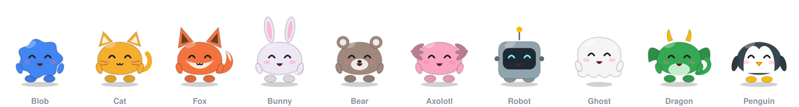</p>

Pip sits on top of your other windows, in a transparent window shaped like the pet itself, so clicks and file drags
pass through everywhere else. Pick a species, colour, accent, pattern, eyes, hat, face and neck item on the **Pet** page.

<table>
  <tr>
    <td align="center" width="40%">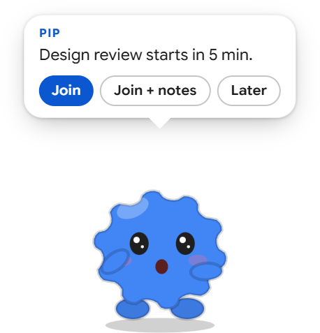</td>
    <td><b>Meetings, on time.</b> Pip tells you when a meeting is about to start, with <b>Join</b> and <b>Join + notes</b>.
    It brings the pre-meeting brief, offers to take notes when Zoom, Teams, Meet, Webex or Slack starts using your
    microphone, and when you hang up offers to write the notes.</td>
  </tr>
  <tr>
    <td align="center">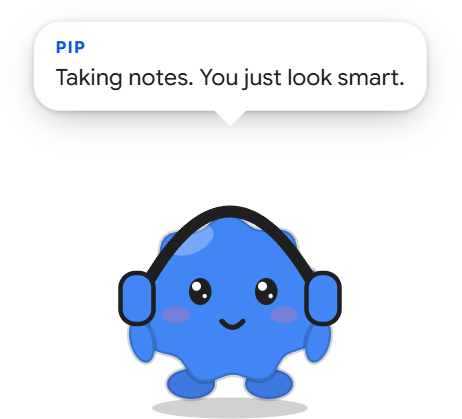</td>
    <td><b>Moods that mean something.</b> Headphones while you are recording, a notepad while notes are written,
    sleepy after a quiet stretch, a little stressed on back-to-back days, and a dance when your notes are ready.
    It nudges you before a promise is due (Done / Tomorrow / Open).</td>
  </tr>
  <tr>
    <td align="center"></td>
    <td><b>Play with it.</b> Rub it to pet it (hearts), drag it, throw it and watch it bounce off the screen edge with
    gravity on. Click for a fun fact or joke, double-click to open Ask, right-click for the menu (captions, wander,
    gravity, sounds, shoo for an hour).</td>
  </tr>
</table>

<p align="center">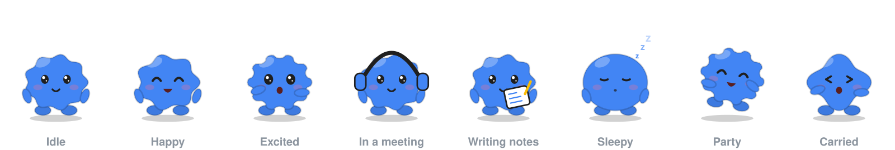</p>

| | |
|---|---|
| **Feed it files** | Drop a file or folder on Pip and Insight indexes it for Ask. |
| **Ask by voice** | <kbd>Ctrl</kbd>+<kbd>Shift</kbd>+<kbd>K</kbd> from any app; Pip answers from your files and meetings. |
| **Show or hide** | <kbd>Ctrl</kbd>+<kbd>Shift</kbd>+<kbd>P</kbd>. It also hides by itself during full-screen slides, videos and games. |
| **Grows with you** | Earns XP from meetings, notes, petting and feeding; levels and badges unlock new items. |
| **Your language** | Speaks any of the 39 interface languages, sassy or wholesome, with quiet hours and optional AI-written lines. |

### Team pets (new in 0.5)

Everyone on a team picks the same folder they already sync (OneDrive, SharePoint, Google Drive for desktop, Dropbox or
a network share) on the **Team** page. Your pet can then walk over to a teammate's screen:

- **Wave.** Their pet visits with a hello; they can wave back.
- **Find time.** Insight finds slots that fit everyone's working hours, time zones and calendars, then books it in
  Google Calendar or Outlook (with "Allow actions" on) or sends an invite file.
- **Send notes.** Hand over a meeting's notes; the teammate chooses whether to save it to their meetings.
- **Stand-up.** A daily stand-up pre-filled from your promises (done since yesterday, due today); post it and ping
  whoever has not posted yet.

Teammates see your name, email, pet, time zone, work hours and busy times (start and end only, never titles). There is
no Insight server: only small files in a hidden `.insight-team` folder, moved by your sync app.

## Requirements

- Windows 10 (1803+) or 11, x64. Node.js 20+ to build from source.
- **Light / Cloud** preset: any modern CPU, 8 GB RAM, about 1.5 GB disk, a Gemini API key (or any OpenAI-compatible API).
- **Balanced**: 6–8 GB GPU. **Full offline**: GPU with 10 GB+ VRAM, about 10 GB disk.

Setup detects your hardware and recommends a preset.

## Quick start

```powershell
npm install
npm run dev
```

The app opens on **Setup**: pick a preset, then **Download and set up**. It fetches the newest llama.cpp release and the
models, resumes interrupted downloads and starts the local model servers.

Or download from the command line (same folder and manifest the app uses):

```powershell
npm run setup:models -- --backend cpu --no-llm --asr sensevoice --speaker                        # Light / Cloud
npm run setup:models -- --backend cuda --model gemma-4-E4B --asr sensevoice,parakeet --speaker   # Full offline
npm run setup:models -- --whisper large-v3-turbo      # Whisper for languages the fast engines don't cover
npm run setup:models -- --update                      # newest llama.cpp release
npm run setup:models -- --check                       # show what is installed
```

Build the installer: `npm run dist` → `dist/Insight-Setup-<version>.exe`.

## Connecting accounts (optional)

**Google** (Settings → Google account): in Google Cloud Console create an OAuth client of type *Web application*, add the
redirect URI `http://127.0.0.1:47820/oauth/callback`, and enable the Gmail, Calendar, Chat, Drive and People APIs plus their MCP
APIs. Paste the client ID and secret. Access is read-only unless you turn on **Allow actions**.

**Microsoft 365** (Settings → Microsoft 365): in Microsoft Entra admin center register an app, add the platform
*Mobile and desktop applications* with redirect URI `http://localhost`, and allow public client flows. Paste the
Application (client) ID; tenant `common` accepts any account, or use your tenant ID.

Tokens are stored encrypted with Windows DPAPI and never reach the interface process.

## Models

| Role | Repository | File picked |
| --- | --- | --- |
| Notes, chat, Live Assistance, audio | `ggml-org/gemma-4-E4B-it-GGUF` (or `-E2B-`) | `*Q8_0*.gguf` (or `Q4_K_M`) + `mmproj*.gguf` |
| Search / retrieval | `ggml-org/embeddinggemma-2-GGUF` | `*Q8_0*.gguf`, else BF16/F16 |
| Speech: JA/EN/ZH/KO/YUE | sherpa-onnx `asr-models` release | `sherpa-onnx-sense-voice-zh-en-ja-ko-yue-int8-2025-09-09` |
| Speech: 25 European languages | sherpa-onnx `asr-models` release | `sherpa-onnx-nemo-parakeet-tdt-0.6b-v3-int8` |
| Speech: Japanese | sherpa-onnx `asr-models` release | `sherpa-onnx-zipformer-ja-reazonspeech-2024-08-01` |
| Speaker labels | sherpa-onnx `speaker-recongition-models` release | `3dspeaker_speech_campplus_sv_zh_en_16k-common_advanced.onnx` |
| Speech: 99 languages | `ggerganov/whisper.cpp` | `ggml-large-v3-turbo-q5_0.bin` or `ggml-base.bin` |
| Runtime | `ggml-org/llama.cpp` releases | CUDA, Vulkan or CPU Windows build |

File names resolve at download time through the Hugging Face and GitHub APIs. Edit `src/shared/catalog.json` to change
repositories or quant preferences. Set `HF_TOKEN` only for gated repositories, `GITHUB_TOKEN` if the GitHub API
rate-limits you.

## How it works

```
mic ─────────┐                                         ┌─ "You" lines
             ├─ 16 kHz mono ─ VAD ─ speech engine ─────┤
loopback ────┘   (renderer AudioWorklet)               └─ "Others" ─ echo filter ─ speakers ─ Live Assistance / captions
your notes + transcript + slides ─ AI model ─ enhanced notes ─ promises, follow-through
files / calendar / bookmarks / meetings ─ EmbeddingGemma 2 + keywords ─ top-k ─ AI model ─ answer with [n]
```

- Local model servers listen only on 127.0.0.1: Gemma on 47811, EmbeddingGemma on 47812, Whisper on 47813.
- AI provider: Gemma 4 on this PC, the Gemini API, or any OpenAI-compatible API (OpenAI, Groq, OpenRouter, Ollama,
  LM Studio). Search and embeddings always stay local.

## Data

Everything lives in `%LOCALAPPDATA%\Insight` (override with `INSIGHT_HOME`):

```
models\        model files + manifest.json
runtime\       llama.cpp / whisper.cpp builds
meetings\<id>\ meeting.json, audio\ segments, slides\
index\         search chunks + vectors
i18n\          cached interface translations
logs\          model server logs
settings.json  sources.json  chat.json  commitments.json  briefs.json  pet.json  secrets.json (encrypted)
```

Delete the folder to remove all data. Your source files are never modified. Installs from before the rename to Insight
are moved from `Foresight` folders automatically on first start.

## Project layout

```
src/main/          Electron main process
  index.ts         windows, tray, loopback capture, lifecycle
  ipc.ts           IPC handlers
  downloader.ts    resumable downloads, manifest       runtime.ts   llama-server / whisper-server
  llm.ts           AI providers, tool loop              asr.ts       speech engine routing
  meetings.ts      transcription, Live Assistance, notes, follow-ups
  ingest.ts        sources, indexing, hybrid search     chat.ts      Ask with citations
  commitments.ts   promises + nudges                    brief.ts     pre-meeting briefs
  google.ts mcp.ts calendar.ts gactions.ts             Google account, read-only MCP tools, calendar, actions
  microsoft.ts     Microsoft Graph                      detect.ts    call detection
  captions.ts      live captions window                 slides.ts    slide capture
  people.ts        people memory                        recap.ts     weekly recap
  pet.ts           desktop pet window                   i18n.ts      interface translation cache
src/preload/       contextBridge API (window.insight)
src/renderer/      React + MUI: main window, pet/, captions/
src/shared/        types, languages, catalog.json, presets, pet catalogue
scripts/           setup-models.mjs (CLI downloader), check-*.mts self-checks
```

Checks: `npm run typecheck`, then `node --experimental-transform-types scripts/check-i18n.mts` (also `check-pet`,
`check-join-url`).

## Troubleshooting

- **Gemma cannot read audio**: your llama.cpp build or mmproj lacks Gemma 4 audio. Run
  `npm run setup:models -- --update`, or pick another speech engine in Settings.
- **Model server stopped**: read `logs\llm.log`. Out of VRAM → lower GPU layers or choose a smaller model.
  Unknown flag → remove it from "Extra llama-server arguments".
- **No system audio**: some exclusive-mode apps and Bluetooth headsets in hands-free mode block loopback; the mic still works.
- **SmartScreen** warns about the unsigned installer: More info → Run anyway.

## Privacy

With the local AI model and no connected accounts, Insight makes no network requests after setup. With a cloud AI
provider, transcripts and notes (never audio, unless you choose cloud speech recognition) are sent to that provider.
Recording people may require their consent where you live, so tell participants before you start listening.

## Licence

MIT. Model weights are under their own licences; see each model card.

Inspired by Google's AI Edge Foresight. Insight is an independent project, not affiliated with Google.
